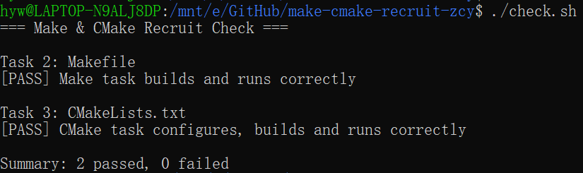

# Task 4：思考题

## 1. Make 和简单的 build.sh 有什么区别？

`build.sh` 会直接都把所有 `.c` 文件重新编译一遍。
`Make` 会看文件的修改时间。改过的才重新编译，没改的直接跳过。
内容越多，Make 省的时间越多。

## 2. CMake 是编译器吗？

执行 `cmake --build build` 时，最终是谁在编译 C 源文件？

CMake 不是编译器。
它只负责读 `CMakeLists.txt`，然后生成构建文件（比如 Linux 下生成 Makefile）。
真正把 C 代码编译成机器码的是 `gcc`。

## 3. 为什么不希望每次都重新编译所有 `.c` 文件？

因为编译很慢。全量重编可能要几十秒甚至几分钟，只编改过的就能达到目的了。
而且没改过的文件重新编译，结果还是一样，太浪费时间。

# 运行结果
